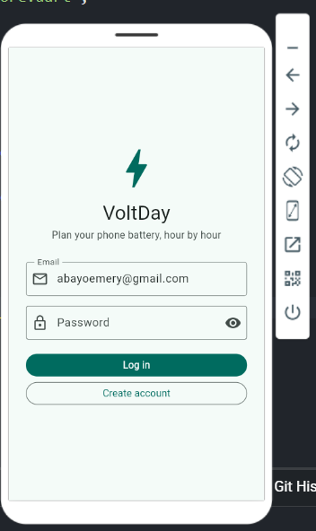
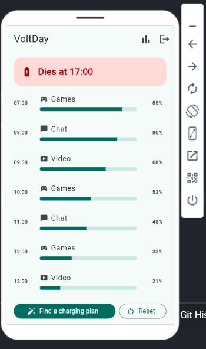
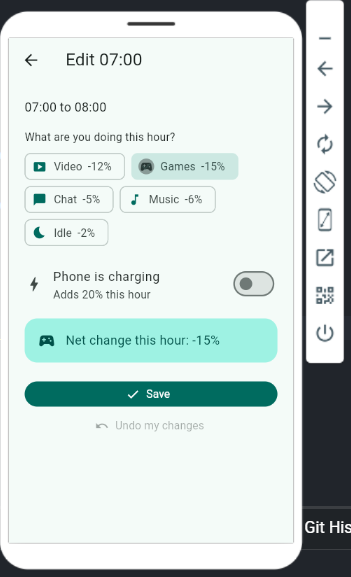
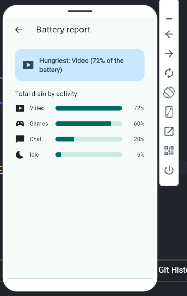
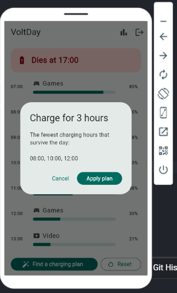
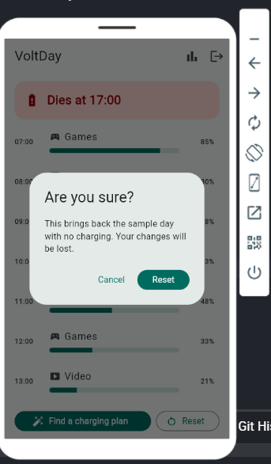

# VoltDay (Battery Planner)

**Name:** Emery ABAYO
**Course:** Mobile Programming, Innovation Center, Kigali
**Project chosen:** Battery Planner (Session 4 mini project), with Firebase added (Session 6)
**App name:** VoltDay

VoltDay helps you plan a phone battery from 7:00 to 23:00. You choose what you
do each hour and when the phone charges, and the app shows whether the battery
survives the day or when it dies.

## Screenshots

| Login | Day screen |
|---|---|
|  |  |

| Edit hour | Battery report |
|---|---|
|  |  |

| Charging plan | Reset confirmation |
|---|---|
|  |  |

## Features
- **Log in / create account** with email and password (Firebase Auth). An auth
  gate switches between the login screen and the day screen by itself.
- **Day screen:** 17 hours (07:00 to 23:00), each with its activity, a battery
  bar and the battery percentage. The bar turns red below 20%. A banner shows
  "Dies at HH:00" or "Survives with N% left". Hours after the phone dies show
  "Dead".
- **Edit hour screen:** pick the activity, switch charging on or off and see the
  net change for that hour. "Undo my changes" fixes a mistake before saving.
- **Battery report:** the total drain per activity, highest first, and the
  hungriest activity named at the top.
- **Find a charging plan:** finds the fewest charging hours that make the day
  survive, and applies them in one tap.
- **Reset:** brings back the sample day with no charging, after an
  "Are you sure?" dialog.
- **Cloud data:** every user's day is stored in Cloud Firestore and updates live
  on screen. Security rules let each user read and write only their own data.

## The rules
- The day runs from 7:00 to 23:00 and the battery starts at 100%.
- Drain per hour: video 12, games 15, chat 5, music 6, idle 2.
- A charging hour adds 20.
- Each hour: subtract the drain, add 20 if charging, then keep the result
  between 0 and 100.
- The phone dies at the end of the first hour that reaches 0%. Later hours are
  shown as dead.

## How it is built
- **Screens:** `login_screen.dart`, `day_screen.dart`, `edit_hour_screen.dart`,
  `report_screen.dart`. `auth_gate.dart` chooses between login and the day.
- **Data between screens:** the day screen passes an `HourSlot` to the edit
  screen, which returns the edited copy. The report screen receives the list of
  hours.
- **Model and rules:** `hour_slot.dart` holds the `HourSlot` class, the sample
  day and all the rules (simulation, banner, report totals, charging plan) as
  functions outside the widgets.
- **Firestore:** `day_data.dart` reads and writes `users/{uid}/hours`, one
  document per hour with the fields `hour`, `activity` and `charges`.
- **Saved facts, computed values:** only `hour`, `activity` and `charges` are
  saved. The battery after each hour, the banner, the report and the charging
  plan are computed every time and never saved.
- **Security rules:** `firestore.rules`, published in the Firebase console.

## Think questions

**1. Does when you charge matter, or only how much?**

Yes, when you charge matters, not only how much. In my app, charging at 7:00,
8:00 and 9:00 makes the phone die at 20:00, but charging for the same number of
hours at 8:00, 11:00 and 12:00 survives with 2% left. Charging early is wasted
because the battery is already near 100%, so the extra charge is lost. Charging
later, after the battery has dropped, keeps all of it. It also depends on the
activities, because video and games drain much more than chat or idle, so
charging helps most during the heavy hours. I would still advise keeping the
phone charged.

**2. Why clamp 0 to 100 every hour, not only at the end?**

Because a battery can only hold between 0 and 100%. If I only clamped at the
end, charge added early in the day would pile up above 100% (for example 105%)
and give extra hours that are not real. A battery that ran out would also keep
going below 0 instead of being dead. Clamping every hour throws away the extra
charge when the battery is full and stops it at 0, so every hour starts from a
real value.

## How to run
1. Create a Firebase project, turn on Email/Password sign-in and create a
   Firestore database in production mode.
2. Publish the rules in `firestore.rules`.
3. Add `firebase_core`, `firebase_auth` and `cloud_firestore` to `pubspec.yaml`
   and run `flutter pub get`.
4. Put your own Firebase web config in `lib/firebase_options.dart`.
5. Run the app and create an account.